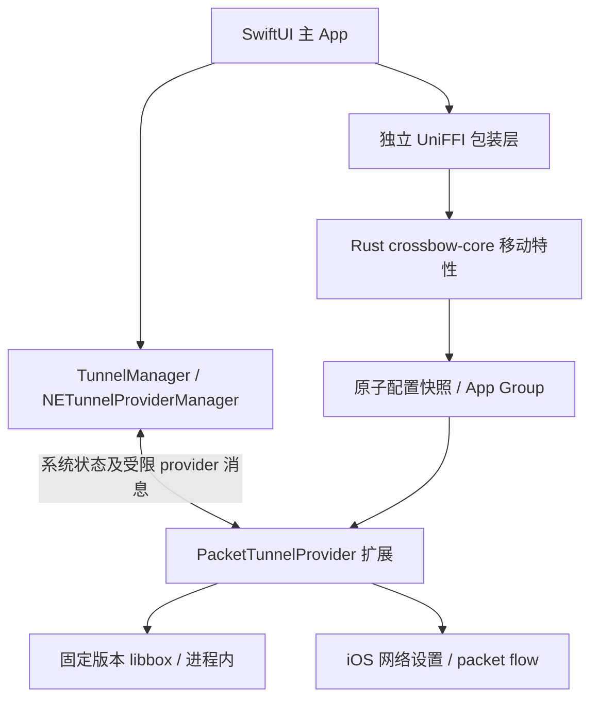

# Crossbow iOS 首版设计

状态：设计提案，关联 #124；尚未实现真实隧道。核对日期：2026-10-26。

本阶段用户确认：已有付费个人 Apple Developer Program 账号；先在自己的 iPhone 上测试，再进入 TestFlight。测试设备为用户提供的 iPhone 17 标准版 / iOS 27.0.1，并要求为后续 iPhone duo 留出适配空间。本文不预设尚未确认的未来设备尺寸、折叠方式或 SDK 能力。

[可点击界面草图](ios-preview.html) 使用全部模拟数据，不安装 VPN、不请求网络、不读取订阅。用浏览器打开即可。草图表示信息结构和状态流转；最终使用原生 SwiftUI 组件、安全区、字体与系统材质，不照搬浏览器模拟的手机边框。

本文细化并调整 `DESIGN.md` / `ROADMAP.md` 中旧 M2 草案：云同步延期；扩展内不引入完整 Rust/JS 运行时；首版不宣称兼容所有 Clash 配置。桌面功能及分发流程不变。

## 1. 当前实际基础

| 项目 | 仓库现状 | 需要补齐 |
|---|---|---|
| `apps/ios` | 两个 Swift 占位文件、XcodeGen 描述 | 完整 App、扩展嵌入、Info/entitlements 与签名验证 |
| PacketTunnel | `startTunnel` 固定返回「待实现」 | 网络设置、平台接口、libbox 生命周期和控制通道 |
| Rust 共享层 | 订阅、模型、存储、覆写、Clash→sing-box 转换 | UniFFI 包装、iOS 编译、移动运行时配置与兼容诊断 |
| 配置转换 | 默认输出桌面 mixed inbound，包含桌面可用规则 | 独立的移动配置适配；不套用桌面自动路由参数 |
| 工程权限 | 主 App 有 NE 声明，扩展描述不完整；未声明嵌入依赖和扩展入口类 | 两个 target 的权限、显式 Bundle ID、App Group、扩展依赖与入口 |
| 依赖 | 共享 crate 无 UniFFI；`boa_engine` 为必选依赖 | 移动特性拆分，首版关闭 JS 覆写，避免把重型依赖带进扩展 |

本机已确认完整 Xcode 27.0（27A266a）、iOS 27.0 模拟器运行时；`xcodegen` 尚未发现。未检查或读取开发者私钥；设备签名和隧道还未验证。模拟器可检查布局，真实隧道、后台和网络切换必须用 iPhone。

最低系统初步建议 iOS 17；现有骨架是 iOS 16，后续根据锁定的 libbox/Rust 依赖和设备范围作明确工程决策。本次不修改 deployment target。

## 2. 产品与视觉

延续 Crossbow 的蓝紫强调色和简洁卡片；主操作、列表、导航、弹出页使用 iOS 原生交互。支持浅色、深色、跟随系统、动态字体、VoiceOver、减少动态效果；交互热区至少 44pt。加载用轻量旋转指示，不用默认绿色长进度条。

| 页面 | 首屏内容 | 主要操作 |
|---|---|---|
| 首页 | 系统隧道状态、连接按钮、当前节点、配置、上下行速率 | 连接/断开、选节点、规则/全局/直连、站点检查入口 |
| 代理 | 策略组选择、自动选择、按地区分组的节点、延迟状态 | 搜索、选择、测速；选择后留在列表，不强制关闭 |
| 配置 | 当前配置、本地/远程来源、更新时间、更新结果 | 用户主动粘贴 URL 或选择文件导入、更新、切换 |
| 设置 | 外观、版本、隧道选项、日志、网络诊断、通知历史、许可 | 查看详情和诊断；高级选项收纳到下一级 |

首页只使用一个「连接」入口。iOS 流量交由 PacketTunnel 扩展，不展示桌面端「系统代理 + TUN」双开关，也不提供内核进程、监听端口或管理员密码等桌面概念。

### 自适应与未来设备

- 按可用窗口宽度、横竖屏、Dynamic Type 和 safe area 布局，不按机型字符串分支。
- 紧凑宽度使用四 Tab；宽窗口采用原生可适配导航/分栏，内容设可读最大宽度。首版先覆盖 iPhone，宽屏布局为后续复用准备，不宣称 iPad 已完整支持。
- 节点行先保留状态和必要操作，长名称优先换行/详情，不把所有文本挤成省略号；自动选择的当前节点可用副标题展示。
- 你提到的 iPhone duo 作为未来设备验收项。若有双屏/折叠形态，随公开 SDK 和设备尺寸补充窗口变化、状态恢复、键盘与旋转测试；不硬编码传闻中的屏幕参数。
- 用窄屏/大字体/横屏/宽窗口测试布局；主内容、连接按钮不被系统浮层或底部导航遮挡。

### 节点与测速

- 自动选择固定第一项；其下按国家/地点分组。国旗与名称用 `🇯🇵 | 名称`，竖线两侧留空格。
- 当前选项使用统一的加粗系统 checkmark；延迟右对齐，数字垂直居中。
- 未测「—」；排队/测速用小型 spinner +「测速中」；成功显示毫秒；0、超时、断连显示失败/超时，不得出现绿色 `0ms`。
- 选中行覆盖完整内容区域，保留容器与行内两侧间距；列表点选留在当前页面。
- 自动选择表示 URLTest 对配置测试目标测得的最低可用延迟，不承诺最高下载带宽或每个站点都最快。无可用结果显示不可用；避免把失败值当最优值。

### 通知与连接状态

沿用 `docs/NOTIFICATIONS.md` 的统一语义，在 SwiftUI 实现顶部应用内通知与通知历史；不是新写一套页面私有 toast。首次系统 VPN 授权仍使用系统对话框；首版不为了普通提示申请系统推送权限。

同一操作复用 operationId，错误可展开脱敏详情和进入诊断。连接阶段显示「准备配置 / 等待系统授权 / 连接中」；系统状态确认后才显示连接，不在用户点击时提前改成成功。隧道连接与站点连通是独立状态，不能因一个站点返回 403 就判定整个 VPN 断开。

## 3. 架构

### 主 App

- 订阅导入/更新、协议识别、转换、兼容诊断、UI 和通知。
- Rust 通过单独 FFI crate 暴露小接口：解析、验证、渲染移动配置、读取 profile 元信息。不把 desktop crate、Tauri、进程管理、系统代理带到 iOS。
- 主 App 是配置源数据的唯一写入者；耗时转换与下载离开主线程。

### 隧道扩展

- 独立 target，内嵌到主 App；通过 `NETunnelProviderManager` 管理。`NEPacketTunnelProvider` 承载实际代理流量，集成 libbox 的平台接口及生命周期。
- 第一版只运行固定版本 libbox 和必要 Swift 代码，不链接完整 crossbow-core/Boa。主 App 即使不在前台，也不能成为维持隧道转发的依赖。
- 通过 App Group 读取已校验的不可变配置快照，写入自己拥有的运行状态/有限日志文件；不会同时改写主 App Store。
- 采用受限 provider 消息发送节点选择、测速、状态查询；字段有版本、请求 ID、大小限制和超时。具体 libbox 控制 API 在集成验证时锁定，不凭空假定它与 mihomo REST 完全相同。
- 不对局域网暴露控制器；首版不额外开启 mixed 代理端口。状态/速率按需、低频取样；后台不依赖主 App 高频轮询。

### 配置一致性与安全

1. 主 App 生成包含 schemaVersion、profileID、revision、coreVersion、digest 的快照；先写临时文件再原子替换。
2. 扩展验证快照与当前 libbox 版本，再设置 DNS/路由并启动内核；保存 last-known-good。
3. 切换配置失败保留/恢复上一个可用快照，并报告实际状态。开关快速连点、启动超时、用户中途取消必须串行处理且忽略旧请求回调。
4. 系统 `NEVPNStatus` 及扩展回报是运行状态来源；订阅选择或历史偏好不是「已连接」证据。用户在系统设置断开 VPN 后，应用同步关闭，不自行反复抢回。
5. 订阅 URL/令牌和密钥采用 Keychain 及必要的共享访问组。含密码的渲染配置使用受保护 App Group 文件，限制读写并排除非必要备份；不把凭据写入 UserDefaults、公开诊断或通知。
6. 首次解锁后文件可用性与后台访问策略必须真机验证；锁屏不能导致现有隧道误读不可访问文件。日志按条数/字节/期限限制，导出前再次脱敏。
7. 不在后台自动切换其他 VPN、不删除其他 VPN 配置；权限被拒绝、配置被系统删除时显示明确恢复步骤。

## 4. 内核与兼容边界

选型为原生 SwiftUI + NetworkExtension + sing-box/libbox；复用共享业务逻辑，不复用桌面的 sidecar 进程。参照 SagerNet 官方 Apple 客户端的隧道与平台接口，但不能直接复制其名称、签名、配置 ID 或发行包。

现有转换器锁定 `SINGBOX_VERSION = 1.14.2`，这不是已经构建出同版本 iOS libbox 的证据。实施前锁定上游 tag/commit、Go/gomobile 工具链、构建标志与 XCFramework 切片；转换器和 libbox 必须一起通过真实配置测试。不假设上游每个 release 都附带可直接嵌入的 Framework；必要时从固定源码可复现构建。

| 范围 | 首版策略 |
|---|---|
| 本地 sing-box JSON | 作为最小隧道验证输入，校验固定版本 schema |
| Clash YAML / 已有订阅 | 复用可转换子集：SS、VMess、Trojan、VLESS、Hysteria2 等；每个协议需真实样例验收 |
| Selector / URLTest、域名/IP 规则 | 明确映射后支持；DNS、远程规则集有单独下载/启动校验 |
| PROCESS-NAME / 任意按 App 分流 | 普通 iOS App 首版不提供；发现规则时明确报兼容错误，不悄悄丢弃或宣称已生效 |
| 其他协议/复杂 Clash 特性 | 报具体不支持项；不能把桌面支持等同于 iOS 支持 |
| merge 覆写 | 在主 App 编译配置时处理，限定可支持字段 |
| JS 脚本覆写 | 延期；保留桌面行为，移动 feature 显式关闭，并在导入时说明 |
| 内核下载/热替换 | iOS 内核随签名 App 发布，不能搬用桌面下载可执行内核的流程 |

扩展有严格资源约束，使用设备实测内存/CPU/电量预算，不把某个历史内存数字当所有系统的固定额度。避免巨大连接表、日志及规则集重复留存；IPv6、NAT64/DNS64 和网络切换列为首版验收。

## 5. 实施顺序与交付门槛

后续按 [详细开发路线](IOS-ROADMAP.md) 的 M0–M5 拆分 issue/PR、开发量和真机验收。下表保留架构阶段映射；具体推进以详细路线的门槛为准。

| 阶段 | PR 范围 | 通过条件 |
|---|---|---|
| A · 最小真机隧道 | 修正 XcodeGen target/嵌入/entitlements；固定 libbox；用本地测试配置验证 | 个人开发签名装机，首次授权、连接、断开、锁屏、Wi-Fi/蜂窝切换可复测；日志能解释失败 |
| B · 共享逻辑 | UniFFI 包装、移动 feature、配置与凭据快照、Clash 兼容诊断 | Rust 单测与 arm64 iOS/模拟器构建通过；不支持字段明确报错；旧桌面测试不退化 |
| C · 日用首版 | 四 Tab、订阅、节点/自动选择、测速、速率、诊断和统一通知 | 真机能够导入真实订阅、连通站点；错误和重试、关前台再打开状态一致 |
| D · TestFlight | 签名上传、版本与 build、隐私/出口合规资料、测试说明 | Account Holder 审核分发资格；内部验证，再按 Apple 流程申请外部测试 |

先交付 A 的真实联网结果，再扩展 B/C。证书、协议兼容、内核资源占用是阶段门槛，不在这些未知项验证前承诺固定完工日期。

云同步、iCloud、Widget、快捷指令、On-Demand 自动连接、完整连接列表和脚本覆写放在日用首版之后。App 内更新遵循 TestFlight/App Store 分发，不使用桌面 Tauri updater。

## 6. 用户需要提前准备

### 现在需要

1. 在 Xcode → Settings → Accounts 登录已付费的 Apple 账号，并确认团队。告知 Team ID 即可；账号密码、私钥、p12 不发聊天或提交仓库。
2. iPhone 连接 Mac、信任电脑，按 iOS 提示开启开发者模式；保留当前可用代理作为测试期间的联网备用。
3. 确认最终唯一标识：主 App、PacketTunnel、App Group 使用同一团队下的独立 ID。建议统一现有桌面 `com.richard.crossbow` 的命名体系，具体 ID 以开发者后台可注册为准；当前骨架 `com.crossbow` 不能直接当已登记 ID。
4. 在对应 App ID / 签名配置中启用 App Groups、Network Extensions，确认实际 provisioning profile 包含所需 entitlement。由签名与能力验证结果判断是否还需额外申请，不一概认定所有个人开发测试都要先转换组织账号。
5. 准备一份自己已确认可用的测试订阅，优先含当前常用的 Hy2/VLESS 节点；在本机安全导入。无需把令牌或订阅地址公开在 issue。

完整 Xcode 已有，无需重新购买开发账号；XcodeGen、Rust iOS targets、UniFFI 和 libbox 工具链属于工程实施准备，后续由开发流程安装/配置。

### TestFlight 前再准备

- App Store Connect App 记录、测试说明、反馈邮箱、隐私政策 URL、隐私声明与出口合规问卷。
- 内部测试与外部测试分开；外部 TestFlight 需要按 Apple 的 Beta App Review 流程提交，不能当作免审核的公开分发渠道。
- Apple 当前 5.4 条对提供 VPN 服务的 App 有组织账号要求；Crossbow 的自带配置客户端如何适用，需在分发前向 Apple 确认。个人开发签名可测试不代表 TestFlight 外测或 App Store 已获准；届时根据答复决定账号与区域方案。
- 当前上游 sing-box 与 Apple 客户端的 LICENSE 是 GPL-3.0-or-later，sing-box 另有名称/关联说明限制；Crossbow 声明 GPL-3.0。固定版本后记录许可证、源码/构建信息与第三方声明，并核对预定商店分发条件，不能只凭同为 GPL 就宣称已解决分发许可。

## 7. 验收清单

- 干净安装 → 用户主动导入 → 校验 → 首次系统授权（允许/拒绝）→ 连接 → 真实浏览器访问 → 断开。
- 无网络、坏配置、过期订阅、节点超时、DNS 失败；逐节点 loading，失败不显示 0ms 绿块。
- 快速开关/切换配置；后台/锁屏/切换网络/系统中手动断开；旧异步回调不能覆盖新状态。
- IPv4、IPv6/NAT64；YouTube、X、Google、GitHub 请求与浏览器访问分别验证，HTTP 受限不等于隧道死亡。
- iPhone 17 / iOS 27.0.1 实机；窄屏/大字体/横屏/明暗/减少动态效果/VoiceOver；未来设备窗口变化测试补充到独立用例。
- 前台/后台速率、日志和内存曲线；内核停止或重连后 UI 不维持假运行数据。
- 配置快照失败回退、更新安装后恢复；日志/诊断导出无密码、订阅 token、完整认证 URL。

## 参考来源

- [Apple：Packet tunnel provider](https://developer.apple.com/documentation/networkextension/packet-tunnel-provider)
- [Apple：TN3134 Network Extension provider deployment](https://developer.apple.com/documentation/technotes/tn3134-network-extension-provider-deployment)
- [Apple：iOS supported capabilities](https://developer.apple.com/help/account/reference/supported-capabilities-ios)
- [Apple：外部 TestFlight 测试](https://developer.apple.com/help/app-store-connect/test-a-beta-version/invite-external-testers)
- [Apple：App Review Guidelines §2.5 / §5.4](https://developer.apple.com/app-store/review/guidelines/)
- [SagerNet：Apple 客户端说明](https://sing-box.sagernet.org/clients/apple/)
- [SagerNet：官方 Apple 客户端源码](https://github.com/SagerNet/sing-box-for-apple)
- [sing-box LICENSE（stable，实施时固定 commit）](https://github.com/SagerNet/sing-box/blob/stable/LICENSE)
- [Apple 客户端 LICENSE（实施时固定 commit）](https://github.com/SagerNet/sing-box-for-apple/blob/dev/LICENSE)
